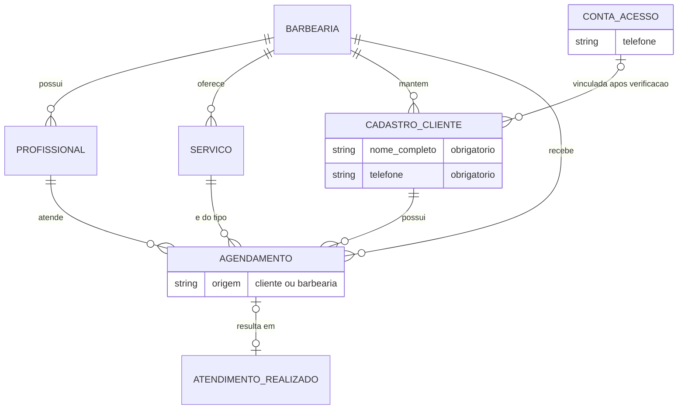
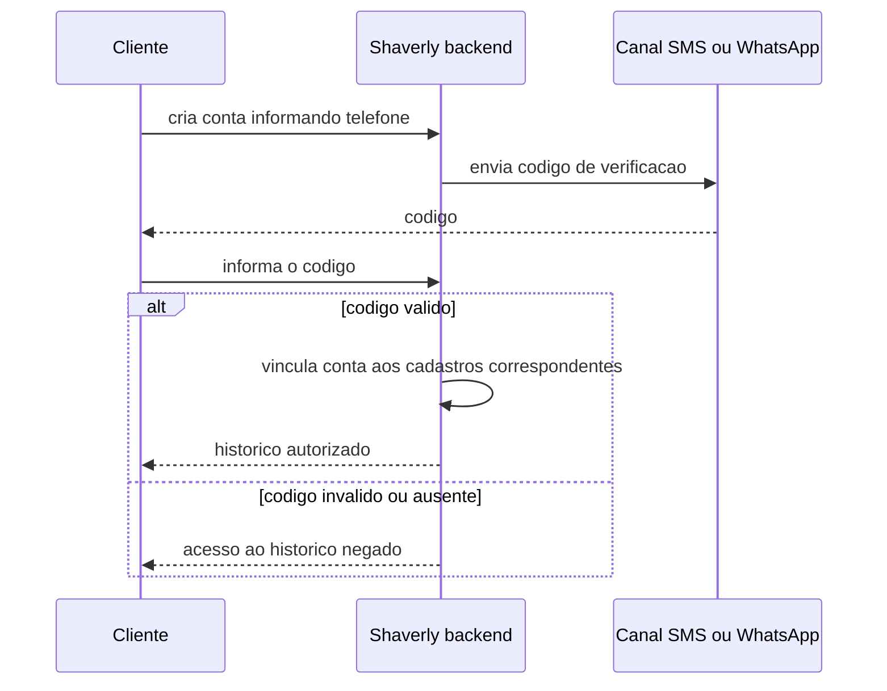

# Shaverly — Visão geral da arquitetura conceitual

> Documento vivo. Descreve o **domínio e as fronteiras** do sistema, não a tecnologia.
> Nenhuma stack, banco de dados ou estilo arquitetural (monólito, microsserviços etc.) foi escolhido; essas decisões pertencem a ADRs em `docs/adr/`.
> Atualizado em 25/11/2026.

## Como ler este documento

Cada item indica sua origem:

- **[Decisão]**: confirmado pela equipe em `docs/requirements.md` (cita a RD correspondente).
- **[Derivado]**: consequência direta de uma decisão, sem escolha nova.
- **[Proposta]**: sugestão a ser revisada pelos dois desenvolvedores. Não é decisão.
- **[Em aberto]**: ainda não definido. Não inventar na implementação.

## 1. Contexto e objetivo

Plataforma para **várias barbearias independentes** gerenciarem agendamentos, clientes e profissionais **[Decisão: RD-005]**. Clientes usam uma **única conta** para agendar em qualquer barbearia **[Decisão: RD-006]**.

Assinaturas, pagamentos e lembretes por WhatsApp fazem parte da visão futura e **não** estão aprovados para o MVP.

## 2. Conceitos do domínio

A linguagem segue o `CONTEXT.md`. Conceitos distintos não devem ser confundidos nos nomes de código.

| Conceito | Significado | Origem |
|---|---|---|
| **Barbearia** | Estabelecimento independente, dono dos seus dados de gestão | RD-005 |
| **Conta de Acesso** | Identidade global e autenticável do cliente | RD-006 |
| **Cadastro de Cliente** | Registro operacional **local a uma barbearia**; pode existir sem conta | RD-003 |
| **Agendamento** | Marcação criada pelo cliente (com conta) ou por usuário autorizado da barbearia | RD-001, RD-002 |
| **Atendimento realizado** | Serviço efetivamente prestado; compõe o histórico | RD-003 (RF-007) |
| **Verificação de telefone** | Comprovação de posse do número por código (SMS ou WhatsApp) | RD-004 |

> **[Proposta]** Separar **Agendamento** (intenção futura) de **Atendimento realizado** (fato ocorrido). A RD-003 diz que o histórico é composto por "serviços efetivamente realizados", o que sugere dois conceitos distintos. Validar com a equipe.

## 3. Modelo conceitual

Diagrama **conceitual**, não um esquema de banco. Os campos são os mínimos confirmados.

Leitura das relações:

- Profissionais, serviços, cadastros de cliente e agendamentos pertencem **a uma única barbearia** **[Decisão: RD-005, RF-012]**.
- Uma **Conta de Acesso** pode ser vinculada a vários Cadastros de Cliente, no máximo um por barbearia **[Derivado: RD-006]**. O vínculo só existe depois da verificação do telefone **[Decisão: RD-004]**.
- Um Cadastro de Cliente **pode existir sem Conta de Acesso** **[Decisão: RD-003]**.

## 4. Fronteiras e responsabilidades

> **[Proposta]** Divisão lógica em módulos. É uma separação de responsabilidades, **não** uma decisão sobre implantação. Pode ser implementada dentro de um único sistema.

| Módulo | Responsabilidade |
|---|---|
| **Identidade e acesso** | Contas de Acesso, autenticação, verificação de telefone |
| **Gestão da barbearia** | Barbearias, profissionais, serviços, usuários internos e seus perfis |
| **Clientes** | Cadastros de Cliente locais e vínculo com Conta de Acesso |
| **Agendamento** | Criação, disponibilidade e regras de agendamentos |
| **Histórico** | Atendimentos realizados e sua consulta autorizada |

## 5. Princípios de segurança

Vêm das RD-004, RD-005 e RD-006 e das aulas de *Secure Systems Architecture*.

1. **Autorização no backend [Decisão: RD-005].** A separação entre barbearias é imposta pelo servidor, nunca só pela interface.
2. **Autenticação não é autorização [Derivado: RD-006].** Ter uma conta global não dá acesso a dados de nenhuma barbearia.
3. **Escopo por barbearia [Derivado: RD-005].** Toda consulta ou alteração de dados de gestão é limitada à barbearia do usuário autorizado. Um usuário da Barbearia A não acessa registros da Barbearia B.
4. **Telefone igual não basta [Decisão: RD-004].** O histórico anterior só é vinculado e exibido após código válido. Enquanto a verificação estiver pendente ou falhar, a consulta é negada.
5. **Falha fechada [Proposta].** Na dúvida (verificação ausente, vínculo ambíguo), negar acesso.

## 6. Fluxos principais

### 6.1 Barbearia cria agendamento para cliente sem conta (RF-004, RF-005, RF-006)

1. Usuário autorizado informa **nome completo** e **telefone** (ambos obrigatórios).
2. O sistema cria (ou reutiliza) um Cadastro de Cliente **dentro daquela barbearia**.
3. O Agendamento é criado associado a esse cadastro, ao profissional e ao serviço.

> **[Em aberto]** Como reutilizar o cadastro quando o telefone já existe na mesma barbearia, e como evitar duplicidade.

### 6.2 Cliente cria conta e recupera histórico (RF-008, RF-009, RF-010)

> **[Em aberto]** Canal prioritário, provedor, expiração, limite de tentativas, reenvio, telefones duplicados, reciclados ou alterados, e como o histórico de várias barbearias é apresentado (Q-007).

### 6.3 Cliente se autoagenda (RF-002, RF-013, RF-014)

1. O cliente se autentica com sua Conta de Acesso (necessária para agendar por conta própria).
2. Escolhe barbearia, serviço, profissional e horário.
3. O agendamento fica associado à barbearia escolhida, respeitando as regras daquele estabelecimento.

## 7. O que este documento não decide

- Linguagem, framework, banco de dados e provedor de autenticação.
- Modelo físico de isolamento entre barbearias (banco único com escopo por barbearia, schemas, bancos separados).
- Monólito versus serviços separados.
- Provedor de SMS ou WhatsApp.
- Esquema físico de tabelas e APIs.

## 8. Questões em aberto que afetam a arquitetura

| Item | Impacto |
|---|---|
| **Q-007**: visão consolidada ou separada por barbearia no histórico do cliente | Telas e consultas do próprio cliente; não bloqueia o fluxo de agendamento |
| Perfis internos autorizados a agendar | Modelo de permissões |
| Quem pode editar ou cancelar agendamentos | Regras de agendamento e permissões |
| Regras de disponibilidade e conflito de horário | Módulo de agendamento |
| Telefone duplicado, reciclado ou alterado | Vínculo entre conta e cadastros |
| Fluxo de cadastro e login | Módulo de identidade |
| Unidades e filiais de uma barbearia | Modelo da Barbearia |

## 9. Próximos passos sugeridos

1. Revisar este documento com o parceiro e ajustar as **[Proposta]**.
2. Escolher a stack e registrar em `docs/adr/0001-stack.md`.
3. Registrar em ADR a estratégia de isolamento entre barbearias.
4. Transformar os critérios de aceitação das RD em testes de comportamento antes da primeira fatia vertical.

## Referências

- [Requisitos e decisões de produto](../requirements.md)
- [Contexto e termos do domínio](../../CONTEXT.md)
- [Registros de uso da IA](../ai-usage.md)
